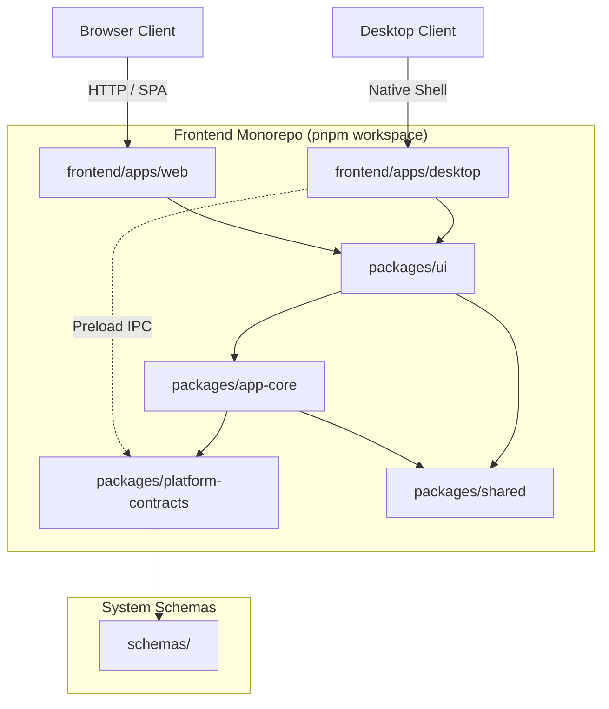

# YourCustomWaifu — Desktop-First Personal AI Companion

A high-performance, type-safe monorepo delivering a unified **Native Desktop Application (Electron)** and **Web Companion Client (Vite SPA)** sharing presentation components, reactive state stores, design tokens, and typed contracts.

The application features **two decoupled desktop surfaces**:
- **Workspace**: Text-focused conversation space, Agent personalization, Memory, Skills, Rules, Tools, AI Model Connections, Avatar Settings, and Account Security.
- **Avatar Stage**: Independent, transparent, frameless desktop window rendering 3D VRM characters with Three.js subtle idle motions (breathing, swaying, blinking) and floating controls, remaining visible above standard desktop applications even after the Workspace is closed.

> **Architectural Scope Notice**
> This repository is strictly scoped as a personal AI companion platform. All legacy experimental neural motion generation, ARDY, MotionStreamer, and PyTorch training pipelines have been permanently purged.

---

## Architecture Overview



---

## Workspace Layout

```text
VRMMotionGeneration/
├── .agents/                    # Agent harness (roles, rules, actionable skills, workflows)
├── .github/workflows/          # CI quality gates (lint, typecheck, test, build)
├── .gitignore                  # Environment, cache, and artifact exclusions
├── .npmrc                      # Strict pnpm workspace configuration
├── .node-version               # Pinned Node.js runtime (v22 / v24)
├── AGENTS.md                   # Operation Dev operating contract
├── README.md                   # Project overview and operational guide
├── CHANGELOG.md                # Version history and reset notes
├── LICENSE                     # MIT License
├── package.json                # Workspace scripts and root test harness
├── pnpm-workspace.yaml         # Monorepo package declarations
├── tsconfig.base.json          # Root TypeScript strict compiler settings
├── frontend/                   # Client presentation domain
│   ├── apps/
│   │   ├── web/                # Browser client (Vite SPA)
│   │   └── desktop/            # Native desktop client (Electron 34+)
│   └── packages/
│       ├── platform-contracts/ # Pure TypeScript interfaces (DesktopAPI, Diagnostics)
│       ├── shared/             # Application constants and helpers
│       ├── app-core/           # Platform detection, state stores, and fallbacks
│       └── ui/                 # Vue 3 components, views, and CSS design tokens
├── backend/                    # Server domain (Explicitly NOT IMPLEMENTED / OPTIONAL)
├── infra/                      # CI workflows and Windows packaging specifications
├── docs/                       # Lifecycle documentation (Discovery, Architecture, Security)
├── diagrams/                   # Derived visual Mermaid projections
└── schemas/                    # Versioned machine-readable JSON Schema contracts
```

---

## Technology Stack

- **Framework**: [Vue 3](https://vuejs.org/) (Composition API, `<script setup lang="ts">`)
- **Language**: [TypeScript 5.7+](https://www.typescriptlang.org/) (strict mode enforced across all packages)
- **Bundler & Dev Server**: [Vite 6+](https://vite.dev/)
- **Desktop Shell**: [Electron 34+](https://www.electronjs.org/) (Hardened security: Context Isolation, Sandboxed, nodeIntegration disabled)
- **Monorepo & Package Management**: [pnpm](https://pnpm.io/) workspaces
- **Testing**: [Vitest 3+](https://vitest.dev/) with JSDOM
- **Code Quality**: [Prettier](https://prettier.io/) + ESLint

---

## Prerequisites

- **Node.js**: `v20.x`, `v22.x`, or `v24.x` (Verified with `v24.18.0`)
- **pnpm**: `v10+` or `v12+` (Verified with `12.14.0`)
- **Git**: 2.30+

---

---

## Desktop Architecture: Two Independent Windows

YourCustomWaifu operates via two decoupled native desktop windows in Electron:

```mermaid
graph TD
    MainProcess[Electron Main Process / Lifecycle Manager] -->|Tray & Global Shortcuts| User[User OS Interaction]
    MainProcess -->|Independent Window 1| WorkspaceWindow[Workspace Window: Chat, Config, Settings]
    MainProcess -->|Independent Window 2| StageWindow[Avatar Stage: Frameless, Transparent, VRM 3D]

    subgraph "Workspace Window Context"
        WorkspaceWindow --> VueUI[Vue 3 Application Shell]
        VueUI --> ChatView[Chatspace: Text-Focused Companion]
        VueUI --> AgentsView[Agent Personalization & Prompts]
        VueUI --> SkillsView[Modular Skills Library]
        VueUI --> RulesView[Operational Constraints & Scopes]
        VueUI --> ToolsView[Permission-Isolated Tools]
        VueUI --> ConnectionsView[AI Model Key Vault]
        VueUI --> MemoryView[Local Memory & Privacy]
        VueUI --> AvatarSettingsView[VRM Loader & Stage Config]
    end

    subgraph "Avatar Stage Context"
        StageWindow --> ThreeWebGL[Three.js WebGL Transparent Canvas]
        ThreeWebGL --> VRMLoader[@pixiv/three-vrm Loader Plugin]
        ThreeWebGL --> IdleEngine[Procedural Breathing & Blink Motion]
        StageWindow --> FloatingToolbar[Hover Floating Controls & Drag Handle]
    end

    MainProcess -->|Typed IPC Events| WorkspaceWindow
    MainProcess -->|Typed IPC Events| StageWindow
```

### 1. Workspace
- Main desktop hub for user interaction, personality editing, and account security.
- Text-focused conversation area: strictly free of anime illustrations or avatar banners.
- Independent lifecycle: closing or minimizing Workspace **does not terminate** Avatar Stage or reset companion runtime state.

### 2. Avatar Stage
- Dedicated frameless, transparent window rendering user-selected `.vrm` avatars with Three.js.
- Always-on-top mode: remains visible above standard desktop applications (e.g. Chrome, VS Code).
- Click-through mode: forward mouse events to underlying windows, restored via `Ctrl+Shift+M` or System Tray.
- Minimal floating toolbar: Drag handle, avatar scale adjust, pause/resume animation, open Workspace, hide Stage.
- Idle animation: subtle procedural breathing, head sway, and natural periodic eye blinking.

### 3. System Tray & Global Shortcuts
- **System Tray Menu**: Open Workspace, Show / Hide Avatar Stage, Pause / Resume Motion, Avatar Settings, Application Settings, Quit Application.
- **`Ctrl+Shift+A`** (`CommandOrControl+Shift+A`): Toggle Avatar Stage visibility globally.
- **`Ctrl+Shift+M`** (`CommandOrControl+Shift+M`): Toggle Stage click-through mode globally.

---

## Getting Started

```bash
# 1. Install all monorepo dependencies
pnpm install

# 2. Run backend auth & identity server
pnpm dev:backend

# 3. Run the Web application in local development mode
pnpm dev:web

# 4. Run the Electron Desktop application (Workspace + Avatar Stage)
pnpm dev:desktop

# 5. Run TypeScript strict typecheck across all packages
pnpm typecheck

# 6. Run lint formatting check
pnpm lint

# 7. Run automated test suites (Vitest)
pnpm test

# 8. Build Web production distribution
pnpm build:web

# 9. Build Electron Desktop production distribution (both Workspace and Stage HTMLs)
pnpm build:desktop
```

---

## Windows Manual Verification Steps

1. **Launch**: Run `pnpm dev:desktop`. Verify Workspace opens and the System Tray icon appears.
2. **Launch Stage**: Click **"Show Stage"** on the top header or in Avatar Settings. Verify the transparent frameless Avatar Stage window appears floating on the desktop.
3. **Workspace Independence**: Close the Workspace window by clicking the `X` button. Verify the Avatar Stage **remains visible and animating** above desktop apps.
4. **Tray Reopening**: Right-click the system tray icon and click **"Open Workspace"**. Verify Workspace re-opens instantly with session, conversation history, and stage status intact.
5. **Global Shortcut**: Press `Ctrl+Shift+A` (or `Cmd+Shift+A`). Verify Avatar Stage toggles between hidden and visible without recreating extra windows.
6. **Click-Through Mode**: Press `Ctrl+Shift+M` or toggle in toolbar. Verify clicks pass directly to desktop applications below. Press `Ctrl+Shift+M` to restore interaction.
7. **Quit**: Right-click the System Tray icon and select **"Quit YourCustomWaifu"**. Verify all windows and processes terminate cleanly.

---

## Electron Security Invariants

In compliance with the [Official Electron Security Checklist](https://www.electronjs.org/docs/latest/tutorial/security/):

1. **`contextIsolation = true`**: Preload scripts execute in a separate context from the web page.
2. **`nodeIntegration = false`**: Node.js APIs are completely inaccessible in the renderer.
3. **`sandbox = true`**: Renderer processes run inside an OS sandbox.
4. **`webSecurity = true`**: Standard same-origin policy is strictly enforced.
5. **Typed IPC Bridge**: Only strongly typed channels (`stage:*`, `workspace:*`, `app:*`) are exposed through `window.desktopAPI`.
6. **Navigation Guard**: External URLs are intercepted and opened exclusively via `shell.openExternal`.

---

## Desktop Documentation
- [Desktop Architecture](file:///c:/Users/PC/Project/VRMMotionGeneration/docs/desktop/ARCHITECTURE.md)
- [Window Lifecycle & Multi-Display Specification](file:///c:/Users/PC/Project/VRMMotionGeneration/docs/desktop/WINDOW-LIFECYCLE.md)
- [Security Baseline & Hardening](file:///c:/Users/PC/Project/VRMMotionGeneration/docs/desktop/SECURITY.md)
- [Authentication & Account Integration](file:///c:/Users/PC/Project/VRMMotionGeneration/docs/desktop/AUTH-INTEGRATION.md)
- [Avatar Stage & VRM 3D Rendering](file:///c:/Users/PC/Project/VRMMotionGeneration/docs/desktop/VRM-STAGE.md)
- [Testing & Release Verification](file:///c:/Users/PC/Project/VRMMotionGeneration/docs/desktop/TESTING-AND-RELEASE.md)
- [Implementation Plan](file:///c:/Users/PC/Project/VRMMotionGeneration/docs/desktop/IMPLEMENTATION-PLAN.md)
- [Codebase Audit & Feature Inventory](file:///c:/Users/PC/Project/VRMMotionGeneration/docs/desktop/CODEBASE-AUDIT.md)

---

## License

This project is licensed under the [MIT License](file:///c:/Users/PC/Project/VRMMotionGeneration/LICENSE).