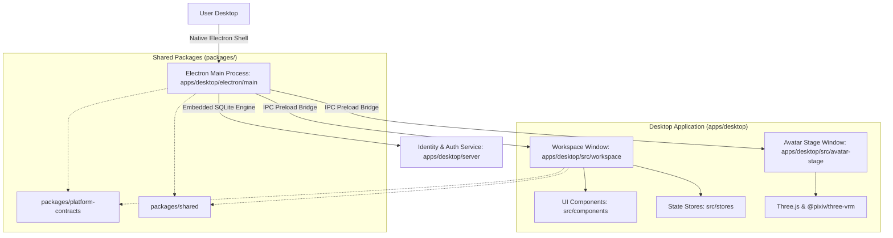

# YourCustomWaifu — Desktop-First Personal AI Companion

A high-performance, type-safe personal AI companion desktop application powered by **Electron**, **Vue 3**, **Vite**, and **Three.js VRM**.

The application features **two decoupled desktop surfaces**:
- **Workspace**: Text-focused conversation space, Agent personalization, Memory, Skills, Rules, Tools, AI Model Connections, Avatar Settings, and Account Security.
- **Avatar Stage**: Independent, transparent, frameless desktop window rendering 3D VRM characters with Three.js subtle idle motions (breathing, swaying, blinking) and floating controls, remaining visible above standard desktop applications even after the Workspace is closed.

> **Architectural Notice — Desktop-Only Application**
> This repository is exclusively structured as an installable Electron desktop application under `apps/desktop/`. Standalone website targets, browser web clients, and obsolete root directories (`frontend/`, `backend/`, `infra/`) have been completely removed.

---

## Architecture Overview



---

## Workspace Layout

```text
YourCustomWaifu/
├── .agents/                    # Agent governance library (roles, rules, skills, workflows)
├── .github/workflows/          # CI quality gates (lint, typecheck, test, build)
├── .gitignore                  # Environment, cache, and artifact exclusions
├── .npmrc                      # Strict pnpm workspace configuration
├── .node-version               # Pinned Node.js runtime (v22 / v24)
├── AGENTS.md                   # Operation Dev operating contract
├── README.md                   # Project overview and operational guide
├── CHANGELOG.md                # Version history and reset notes
├── LICENSE                     # MIT License
├── package.json                # Root workspace scripts and testing harness
├── pnpm-workspace.yaml         # Monorepo declarations (apps/*, packages/*)
├── tsconfig.base.json          # Root TypeScript strict compiler settings
├── vitest.config.ts            # Root Vitest test configuration
├── apps/
│   └── desktop/                # Canonical Desktop Application
│       ├── package.json        # Desktop Electron package manifest
│       ├── electron/           # Main process, preload bridge, and embedded server
│       │   ├── main/           # Window lifecycles, bounds safety, hardening
│       │   ├── preload/        # contextBridge safe desktopAPI exposure
│       │   ├── ipc/            # Typed IPC channels and interfaces
│       │   └── server/         # Embedded SQLite identity & auth service
│       ├── src/                # Vue 3 Renderer Application
│       │   ├── workspace/      # Shell App.vue, main.ts, and 19 companion views
│       │   ├── avatar-stage/   # stage-main.ts Three.js VRM renderer
│       │   ├── components/     # NavigationBar, ShellLayout, StatusBadge, StateView
│       │   ├── stores/         # Pinia / reactive state stores and platform bridge
│       │   ├── assets/         # Dark graphite tokens (tokens.css) & reset (base.css)
│       │   ├── index.html      # Workspace window HTML entry point
│       │   └── stage.html      # Transparent Avatar Stage HTML entry point
│       ├── server/             # Re-exported local identity & authentication engine
│       ├── resources/          # Windows packaging specifications and installer assets
│       └── tests/              # Full unit, lifecycle, security, ui, and auth test suites
├── packages/                   # Shared Type Contracts and Constants
│   ├── platform-contracts/     # Pure TypeScript interfaces (DesktopAPI, StageStatus, IPC)
│   └── shared/                 # Application metadata, default settings, and helpers
└── schemas/                    # JSON Schema specifications for settings and IPC
```

---

## Technology Stack

- **Desktop Shell**: [Electron 34+](https://www.electronjs.org/) (Context Isolation, Sandboxed, strict CSP, nodeIntegration disabled)
- **Framework**: [Vue 3](https://vuejs.org/) (Composition API, `<script setup lang="ts">`)
- **Language**: [TypeScript 5.7+](https://www.typescriptlang.org/) (strict mode enforced across all packages)
- **Bundler & Dev Server**: [Vite 6+](https://vite.dev/)
- **3D Avatar Rendering**: [Three.js](https://threejs.org/) + [@pixiv/three-vrm](https://github.com/pixiv/three-vrm)
- **Local Identity & Auth**: Node.js `node:sqlite` (DatabaseSync, WAL mode, PBKDF2 hashing, `safeStorage` session encryption)
- **Monorepo & Package Management**: [pnpm](https://pnpm.io/) workspaces
- **Testing**: [Vitest 4+](https://vitest.dev/) with JSDOM
- **Code Quality**: [Prettier](https://prettier.io/)

---

## Desktop Architecture: Two Independent Windows

YourCustomWaifu operates via two decoupled native desktop windows in Electron:

```mermaid
graph TD
    MainProcess[Electron Main Process / Lifecycle Manager] -->|Tray & Global Shortcuts| User[User OS Interaction]
    MainProcess -->|Independent Window 1| WorkspaceWindow[Workspace Window: Chat, Config, Settings]
    MainProcess -->|Independent Window 2| StageWindow[Avatar Stage: Frameless, Transparent, VRM 3D]

    subgraph "Workspace Window Context"
        WorkspaceWindow --> VueUI[Vue 3 Application Shell]
        VueUI --> ChatView[Chatspace: Text-Focused Companion]
        VueUI --> AgentsView[Agent Personalization & Prompts]
        VueUI --> SkillsView[Modular Skills Library]
        VueUI --> RulesView[Operational Constraints & Scopes]
        VueUI --> ToolsView[Permission-Isolated Tools]
        VueUI --> ConnectionsView[AI Model Key Vault]
        VueUI --> MemoryView[Local Memory & Privacy]
        VueUI --> AvatarSettingsView[VRM Loader & Stage Config]
    end

    subgraph "Avatar Stage Context"
        StageWindow --> ThreeWebGL[Three.js WebGL Transparent Canvas]
        ThreeWebGL --> VRMLoader[@pixiv/three-vrm Loader Plugin]
        ThreeWebGL --> IdleEngine[Procedural Breathing & Blink Motion]
        StageWindow --> FloatingToolbar[Hover Floating Controls & Drag Handle]
    end

    MainProcess -->|Typed IPC Events| WorkspaceWindow
    MainProcess -->|Typed IPC Events| StageWindow
```

### 1. Workspace
- Main desktop hub for user interaction, personality editing, and account security.
- Text-focused conversation area: strictly free of anime illustrations or avatar banners.
- Independent lifecycle: closing or minimizing Workspace **does not terminate** Avatar Stage or reset companion runtime state.

### 2. Avatar Stage
- Dedicated frameless, transparent window rendering user-selected `.vrm` avatars with Three.js.
- Always-on-top mode: remains visible above standard desktop applications (e.g. Chrome, VS Code).
- Click-through mode: forward mouse events to underlying windows, toggled via `Ctrl+Shift+M` or System Tray.
- Minimal floating toolbar: Drag handle, avatar scale adjust, pause/resume animation, open Workspace, hide Stage.
- Idle animation: subtle procedural breathing, head sway, and natural periodic eye blinking.

### 3. System Tray & Global Shortcuts
- **System Tray Menu**: Open Workspace, Show / Hide Avatar Stage, Pause / Resume Motion, Avatar Settings, Application Settings, Quit Application.
- **`Ctrl+Shift+A`** (`CommandOrControl+Shift+A`): Toggle Avatar Stage visibility globally.
- **`Ctrl+Shift+M`** (`CommandOrControl+Shift+M`): Toggle Stage click-through mode globally.

---

## Getting Started

```bash
# 1. Install all monorepo dependencies
pnpm install

# 2. Run the Electron Desktop application (Workspace + Avatar Stage + Embedded Auth)
pnpm dev

# 3. Run TypeScript strict typecheck across all modules
pnpm typecheck

# 4. Run lint code style check
pnpm lint

# 5. Run automated test suites (37 tests across 7 suites)
pnpm test

# 6. Build production desktop bundles
pnpm build
```

---

## Electron Security Invariants

In compliance with the [Official Electron Security Checklist](https://www.electronjs.org/docs/latest/tutorial/security/):

1. **`contextIsolation = true`**: Preload scripts execute in a separate context from the web page.
2. **`nodeIntegration = false`**: Node.js APIs are completely inaccessible in the renderer.
3. **`sandbox = true`**: Renderer processes run inside an OS sandbox.
4. **`webSecurity = true`**: Standard same-origin policy is strictly enforced.
5. **Typed IPC Bridge**: Only strongly typed channels (`stage:*`, `workspace:*`, `app:*`, `auth:*`) are exposed through `window.desktopAPI`.
6. **Navigation Guard**: External URLs are intercepted and opened exclusively via `shell.openExternal`.

---

## License

This project is licensed under the [MIT License](file:///c:/Users/PC/Project/VRMMotionGeneration/LICENSE).