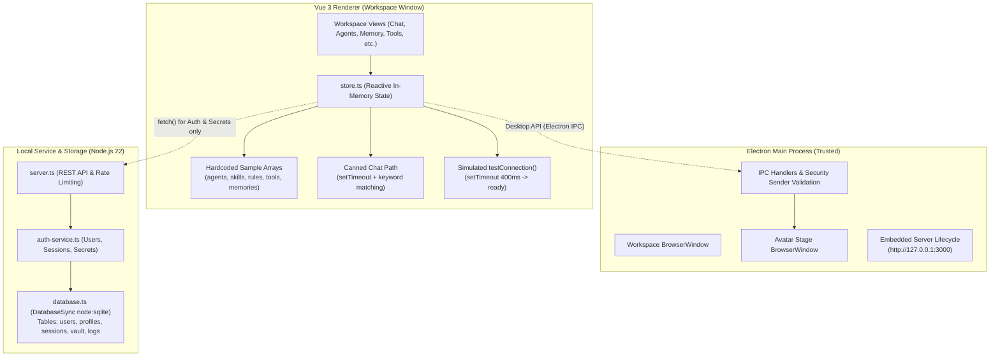
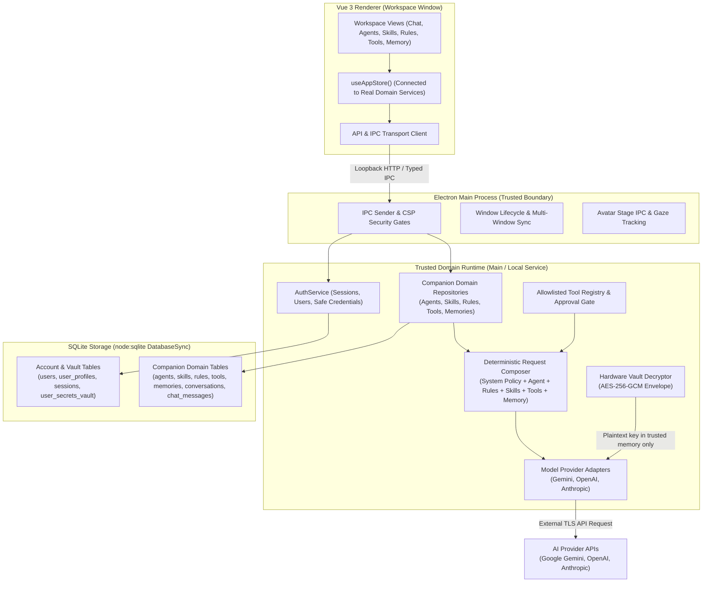
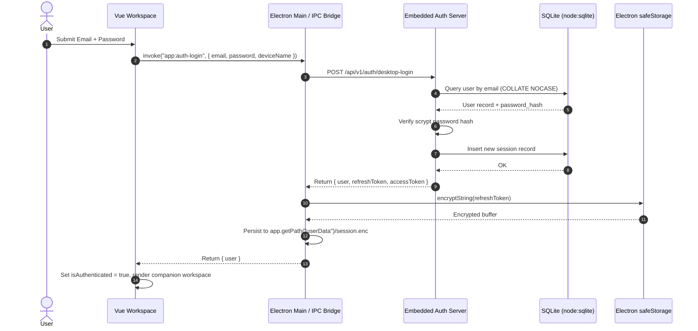
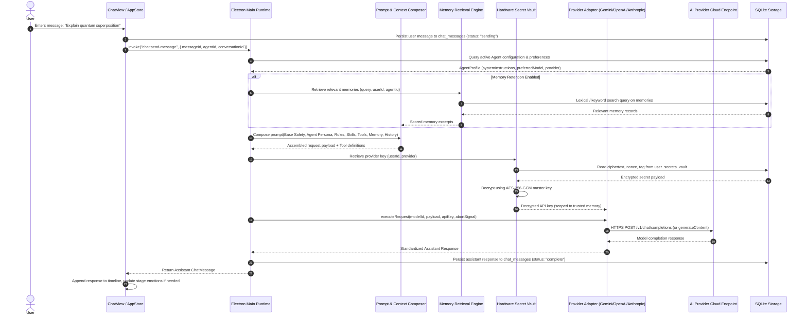
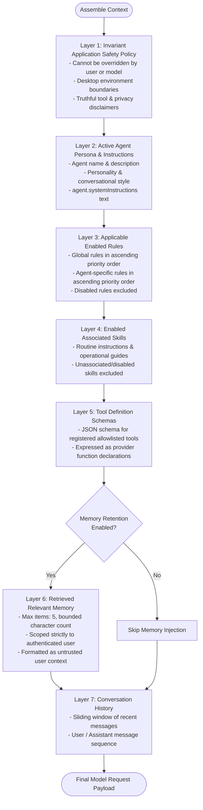
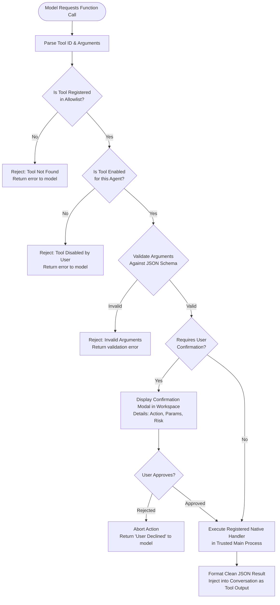

# YourCustomWaifu — Companion Domain Architecture & System Flows

**Document Status:** Canonical Architecture Document  
**Version:** 1.0.0 (Phase 0 Baseline & Target Blueprint)  
**Author:** Operation Dev (Engineering Lead & Delivery Owner)  
**Last Updated:** October 2026

---

## 1. Executive Summary & Audit Baseline

YourCustomWaifu is a desktop-first personal AI companion built with Electron, Vue 3, TypeScript, and Three.js/VRM. The application operates with two independent windows:
1. **Workspace Window:** Multi-tab companion management (Chat, Agents, Skills, Rules, Tools, Model Connections, Memory, Avatar Settings, Account, Security, Secrets, Diagnostics).
2. **Avatar Stage Window:** Transparent, frameless window rendering an interactive 3D VRM avatar with real-time gaze tracking and facial expressions.

### 1.1 As-Is Feature Classification & Audit Evidence

An evidence-based audit of the local repository checkout confirms the following status across all requested domains:

| Domain / Feature | Status | Implementation Evidence | Key Gaps & Observations |
| :--- | :--- | :--- | :--- |
| **Account & Authentication** | `PERSISTED & WORKING` | `apps/desktop/electron/server/auth-service.ts`, `database.ts`, `server.ts` | Complete scrypt hashing, sessions, password reset, account deletion, and profile management. No email verification gate by design. |
| **Hardware / Secret Vault** | `PERSISTED & WORKING` | `auth-service.ts` (`saveSecret`, `getSecrets`), `crypto.ts` (`encryptSecret`, `decryptSecret`) | AES-256-GCM envelope encryption storing ciphertext, nonce, tag, and safe key hint in `user_secrets_vault`. Only safe hints exposed to renderer. |
| **AI Model & Provider Config** | `PARTIAL / MOCK` | `store.ts` (`modelConnections`, `testConnection`) | `testConnection` simulates readiness using `setTimeout(r, 400)` without network or adapter calls. Provider selection is in-memory only. |
| **Agent & System Prompts** | `IN-MEMORY / MOCK` | `store.ts` (`state.agents`, `updateAgent`), `AgentsView.vue` | In-memory reactive array initialized with sample agent "Aiko". Changes do not persist to database; no DB tables exist. |
| **Skills Management** | `IN-MEMORY / MOCK` | `store.ts` (`state.skills`, `addSkill`, `updateSkill`, `deleteSkill`), `SkillsView.vue` | Reactive array with 3 sample items. Operations update memory only; no backend persistence or runtime consumption. |
| **Rules Management** | `IN-MEMORY / MOCK` | `store.ts` (`state.rules`, `addRule`, `updateRule`, `deleteRule`), `RulesView.vue` | Reactive array with 3 sample rules. Priority/scope not enforced by any runtime; no backend persistence. |
| **Tools & Permissions** | `IN-MEMORY / MOCK` | `store.ts` (`state.tools`, `toggleTool`, `updateTool`), `ToolsView.vue` | Mock catalog of 3 tools. No handler registry, argument schema validation, or execution permissions in trusted runtime. |
| **Memory & Privacy Vault** | `IN-MEMORY / MOCK` | `store.ts` (`state.memories`, `addMemory`, `deleteMemory`, `clearAllMemories`), `MemoryView.vue` | Mock array with 2 sample records. No search scoring, retention toggle enforcement, agent scoping, or DB storage. |
| **Chat & Agent Runtime** | `IN-MEMORY / MOCK` | `store.ts` (`sendChatMessage`, `clearChatMessages`), `ChatView.vue` | Canned response path using `setTimeout(r, 600)` and substring matching (`stage`, `who are you`, `memory`). No real model calls. |
| **Avatar Stage Coordination** | `PERSISTED & WORKING` | `apps/desktop/electron/main/index.ts`, `stage-main.ts`, `stage.html` | Independent transparent window, native IPC, cursor tracking, VRM loading, side-mounted kebab menu, and window presets. |

---

## 2. As-Is Architecture vs. Target Architecture

### 2.1 As-Is Architecture (Current Checkout)

### 2.2 Target Architecture (Companion Domain Implementation)

---

## 3. Entity-Relationship Model (Current vs. Proposed)

```mermaid
erDiagram
    %% ==========================================
    %% CURRENT EXISTING TABLES (PERSISTED & REAL)
    %% ==========================================
    users {
        TEXT id PK
        TEXT email UK
        TEXT password_hash
        TEXT status
        INTEGER failed_login_attempts
        TEXT lockout_until
        TEXT created_at
        TEXT updated_at
    }

    user_profiles {
        TEXT user_id PK, FK
        TEXT display_name
        TEXT avatar_url
        TEXT locale
        TEXT timezone
        TEXT updated_at
    }

    sessions {
        TEXT id PK
        TEXT user_id FK
        TEXT token_hash UK
        TEXT client_type
        TEXT device_name
        TEXT ip_subnet
        TEXT idle_expires_at
        TEXT absolute_expires_at
        TEXT revoked_at
        TEXT created_at
        TEXT last_seen_at
    }

    password_reset_tokens {
        TEXT id PK
        TEXT user_id FK
        TEXT token_hash UK
        TEXT expires_at
        TEXT used_at
        TEXT ip_subnet
        TEXT created_at
    }

    user_secrets_vault {
        TEXT id PK
        TEXT user_id FK
        TEXT provider
        TEXT ciphertext
        TEXT nonce
        TEXT tag
        TEXT key_hint
        TEXT created_at
        TEXT updated_at
    }

    audit_logs {
        TEXT id PK
        TEXT user_id
        TEXT event_type
        TEXT status
        TEXT ip_subnet
        TEXT user_agent_summary
        TEXT metadata
        TEXT created_at
    }

    %% ==========================================
    %% PROPOSED COMPANION DOMAIN TABLES (PHASE 01)
    %% ==========================================
    agents {
        TEXT id PK
        TEXT user_id FK
        TEXT name
        TEXT description
        TEXT personality
        TEXT conversational_style
        TEXT system_instructions
        TEXT preferred_provider
        TEXT preferred_model
        TEXT behavior_preferences
        INTEGER is_active
        TEXT created_at
        TEXT updated_at
    }

    skills {
        TEXT id PK
        TEXT user_id FK
        TEXT name
        TEXT description
        TEXT category
        TEXT content
        INTEGER enabled
        TEXT created_at
        TEXT updated_at
    }

    agent_skills {
        TEXT agent_id PK, FK
        TEXT skill_id PK, FK
        TEXT created_at
    }

    rules {
        TEXT id PK
        TEXT user_id FK
        TEXT name
        TEXT content
        TEXT scope
        TEXT applicable_agent_id FK
        INTEGER priority
        INTEGER enabled
        TEXT created_at
        TEXT updated_at
    }

    tools {
        TEXT id PK
        TEXT user_id FK
        TEXT name
        TEXT description
        TEXT category
        TEXT permission_level
        INTEGER requires_confirmation
        INTEGER enabled
        TEXT status
        TEXT created_at
        TEXT updated_at
    }

    agent_tools {
        TEXT agent_id PK, FK
        TEXT tool_id PK, FK
        TEXT created_at
    }

    memories {
        TEXT id PK
        TEXT user_id FK
        TEXT agent_id FK
        TEXT category
        TEXT content
        REAL confidence
        TEXT last_recalled_at
        TEXT created_at
        TEXT updated_at
    }

    conversations {
        TEXT id PK
        TEXT user_id FK
        TEXT agent_id FK
        TEXT title
        TEXT created_at
        TEXT updated_at
    }

    chat_messages {
        TEXT id PK
        TEXT conversation_id FK
        TEXT user_id FK
        TEXT agent_id FK
        TEXT role
        TEXT content
        TEXT status
        INTEGER token_count
        TEXT created_at
    }

    user_provider_settings {
        TEXT id PK
        TEXT user_id FK
        TEXT provider UK
        TEXT selected_model
        TEXT available_models
        TEXT status
        TEXT error_message
        TEXT updated_at
    }

    %% Relationships & Foreign Keys
    users ||--|| user_profiles : "has"
    users ||--o{ sessions : "creates"
    users ||--o{ password_reset_tokens : "requests"
    users ||--o{ user_secrets_vault : "owns"
    users ||--o{ agents : "configures"
    users ||--o{ skills : "manages"
    users ||--o{ rules : "defines"
    users ||--o{ tools : "customizes"
    users ||--o{ memories : "stores"
    users ||--o{ conversations : "holds"
    users ||--o{ user_provider_settings : "maintains"

    agents ||--o{ agent_skills : "attaches"
    skills ||--o{ agent_skills : "linked_to"
    agents ||--o{ agent_tools : "attaches"
    tools ||--o{ agent_tools : "linked_to"
    agents ||--o{ rules : "applies_agent_rule"
    agents ||--o{ memories : "scoped_to"
    conversations ||--o{ chat_messages : "contains"
```

---

## 4. Key Sequence Diagrams

### 4.1 Authentication & Session Resolution Flow

### 4.2 Provider-Backed Chat Execution Flow

---

## 5. Flow Diagrams: Prompt Composition & Tool Execution

### 5.1 Deterministic Effective Prompt Composition

The prompt compiler combines untrusted user text, configuration, and policies in a deterministic, tested precedence order. Private keys, other users' data, and irrelevant memories are strictly excluded:

### 5.2 Tool Authorization & User Confirmation Boundary

---

## 6. Security Architecture & Data Ownership

### 6.1 Trust Boundaries & Process Isolation
1. **Renderer Process (Workspace & Stage):**
   - Strictly isolated with `contextIsolation: true` and `nodeIntegration: false`.
   - Accesses backend capabilities exclusively via narrow, typed IPC bridges or loopback HTTP.
   - Never receives raw database connections, master keys, full provider API keys, or unrestricted Node.js APIs.
2. **Main Process & Local Service (Trusted Layer):**
   - Owns the SQLite database (`DatabaseSync`) and master encryption key.
   - Enforces IPC sender validation using `validateIpcSender(event.sender, allowedWindows)`.
   - Performs envelope decryption of provider secrets only immediately before dispatching HTTPS requests to provider endpoints.
   - Resolves authenticated identity from verified session tokens; never accepts client-provided `userId` parameters as proof of identity.

### 6.2 Data Isolation & Cascade Policy
- Every domain record (`agents`, `skills`, `rules`, `tools`, `memories`, `conversations`, `chat_messages`, `user_provider_settings`) has a foreign key to `users(id)` with `ON DELETE CASCADE`.
- Account deletion requires verifying the current password and typing the explicit confirmation phrase (`DELETE MY ACCOUNT`).
- All queries in the domain repositories must include `WHERE user_id = ?` to enforce complete multi-tenant tenant isolation.

---

## 7. Official References & Standards

1. **Electron Security Guidelines:**  
   [Electron Security Tutorial](https://www.electronjs.org/docs/latest/tutorial/security) — Context isolation, disabling `nodeIntegration`, CSP enforcement, and IPC sender verification.
2. **Node.js SQLite Integration:**  
   [Node.js v22 `node:sqlite` Module](https://nodejs.org/api/sqlite.html) — Synchronous SQLite engine (`DatabaseSync`), WAL mode, parameterized statements, and transaction management.
3. **Google Gemini API Documentation:**  
   [Gemini API Reference](https://ai.google.dev/gemini-api/docs) — Structured text generation, model IDs (`gemini-2.5-flash`, `gemini-2.5-pro`), and system instruction configuration.
4. **OpenAI API Documentation:**  
   [OpenAI API Reference](https://platform.openai.com/docs/api-reference) — Chat completions API (`gpt-4o`, `gpt-4o-mini`), tool calling schemas, and error taxonomy.
5. **Anthropic Claude API Documentation:**  
   [Anthropic API Reference](https://docs.anthropic.com/en/api) — Messages API (`claude-3-5-sonnet`, `claude-3-5-haiku`), system prompts, and tool use formats.
