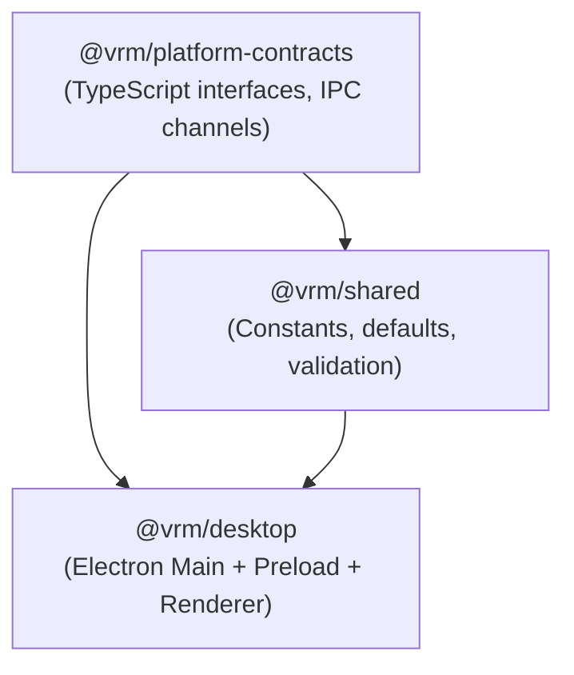

# Dependency Map & Boundary Contracts — YourCustomWaifu

This document traces the component and package dependencies, IPC boundaries, and persistence contracts across YourCustomWaifu.

---

## 1. Package Dependency Hierarchy

### 1.1 `@vrm/platform-contracts`
- **Role:** Pure interface and typing boundary. No runtime dependencies.
- **Exports:**
  - `DesktopAPI`, `DesktopAuthAPI`, `DesktopStageAPI`, `DesktopWorkspaceAPI`
  - `IPC_CHANNELS` enum constants
  - Data models: `UserProfile`, `UserSession`, `ProviderSecretItem`, `AvatarConfig`, `StageStatus`, `BlinkDiagnostic`, `AgentProfile`, `SkillItem`, `RuleItem`, `ToolItem`, `MemoryItem`, `ChatMessage`.

### 1.2 `@vrm/shared`
- **Role:** Runtime constants and schema defaults.
- **Exports:**
  - `DEFAULT_SETTINGS`, `DEFAULT_AVATAR_CONFIG`, `INITIAL_STAGE_STATUS`, `DEFAULT_WORKSPACE_BOUNDS`, `APP_METADATA`.

### 1.3 `@vrm/desktop`
- **Main Process Dependencies:**
  - `electron` (Window management, tray, global shortcuts, `safeStorage`, `ipcMain`)
  - `node:sqlite` (`DatabaseSync` for durable storage)
  - `node:crypto` (`scryptSync`, `createCipheriv`, `createDecipheriv`, `randomBytes`)
  - `node:http` (Embedded loopback server on `127.0.0.1`)
- **Renderer Process Dependencies:**
  - `vue` (Vue 3 Composition API, reactive store)
  - `three` (WebGL 3D scene, camera, lighting, renderer)
  - `@pixiv/three-vrm` (VRM parser, expression manager, look-at, humanoid bones)
  - `vitest` + `@vue/test-utils` (Unit and component test runner)

---

## 2. IPC Communication Contracts

| Channel Identifier | Direction | Source | Target | Handler Location |
| :--- | :--- | :--- | :--- | :--- |
| `app:get-version` | Request-Response | Renderer | Main | `main/index.ts:605` |
| `app:get-diagnostics` | Request-Response | Renderer | Main | `main/index.ts:622` |
| `app:ping` | Request-Response | Renderer | Main | `main/index.ts:648` |
| `app:get-api-base-url` | Request-Response | Renderer | Main | `main/index.ts:655` |
| `app:guest-preview-available` | Request-Response | Renderer | Main | `main/index.ts:612` |
| `app:auth-login` | Request-Response | Renderer | Main | `main/index.ts:663` |
| `app:auth-register` | Request-Response | Renderer | Main | `main/index.ts:700` |
| `app:auth-logout` | Request-Response | Renderer | Main | `main/index.ts:779` |
| `app:auth-get-stored-session` | Request-Response | Renderer | Main | `main/index.ts:791` |
| `stage:get-status` | Request-Response | Renderer | Main | `main/index.ts:833` |
| `stage:get-config` | Request-Response | Renderer | Main | `main/index.ts:840` |
| `stage:get-bounds` | Request-Response | Renderer | Main | `main/index.ts:847` |
| `stage:set-bounds` | Request-Response | Renderer | Main | `main/index.ts:863` |
| `stage:show` | Request-Response | Renderer | Main | `main/index.ts:938` |
| `stage:hide` | Request-Response | Renderer | Main | `main/index.ts:945` |
| `stage:toggle` | Request-Response | Renderer | Main | `main/index.ts:952` |
| `stage:set-clickthrough` | Request-Response | Renderer | Main | `main/index.ts:959` |
| `stage:set-ignore-mouse-events` | Request-Response | Renderer | Main | `main/index.ts:969` |
| `stage:set-alwaysontop` | Request-Response | Renderer | Main | `main/index.ts:983` |
| `stage:set-animation-paused` | Request-Response | Renderer | Main | `main/index.ts:993` |
| `stage:update-config` | Request-Response | Renderer | Main | `main/index.ts:1003` |
| `stage:select-vrm-file` | Request-Response | Renderer | Main | `main/index.ts:1087` |
| `stage:load-vrm-buffer` | Request-Response | Renderer | Main | `main/index.ts:1131` |
| `stage:report-model-status` | Request-Response | Renderer | Main | `main/index.ts:1159` |
| `stage:ensure-sample-vrm` | Request-Response | Renderer | Main | `main/index.ts:1195` |
| `stage:trigger-test-blink` | Request-Response | Renderer | Main | `main/index.ts:1202` |
| `stage:get-blink-diagnostic` | Request-Response | Renderer | Main | `main/index.ts:1210` (Remediated) |
| `stage:status-changed` | Event Broadcast | Main | All Windows | `main/index.ts:123` |
| `stage:config-changed` | Event Broadcast | Main | All Windows | `main/index.ts:135` |
| `stage:cursor-move` | Event Broadcast (30Hz) | Main | Stage Window | `main/index.ts:148` |
| `workspace:show` | Request-Response | Renderer | Main | `main/index.ts:1214` |
| `workspace:hide` | Request-Response | Renderer | Main | `main/index.ts:1221` |
| `workspace:toggle` | Request-Response | Renderer | Main | `main/index.ts:1228` |

---

## 3. Database Persistence Schema Boundaries

The embedded database `DatabaseSync` in `app.getPath("userData")/vrm-auth.db` manages:
1. `users` & `user_profiles`: User identity and display settings.
2. `sessions`: Authenticated sessions indexed by SHA-256 token hash.
3. `user_secrets_vault`: Envelope-encrypted API keys with AES-256-GCM (nonce, tag, ciphertext, safe key hint).
4. `agents`: Personas, system instructions, model preferences.
5. `skills` & `agent_skills`: Capability modules.
6. `rules`: Behavioral operational constraints.
7. `tools` & `agent_tools`: Registered tools and permission gates.
8. `memories`: Categorized user memories with semantic search indexing.
9. `conversations` & `chat_messages`: Complete chat history with role and status.
10. `user_provider_settings`: Active model preferences.
