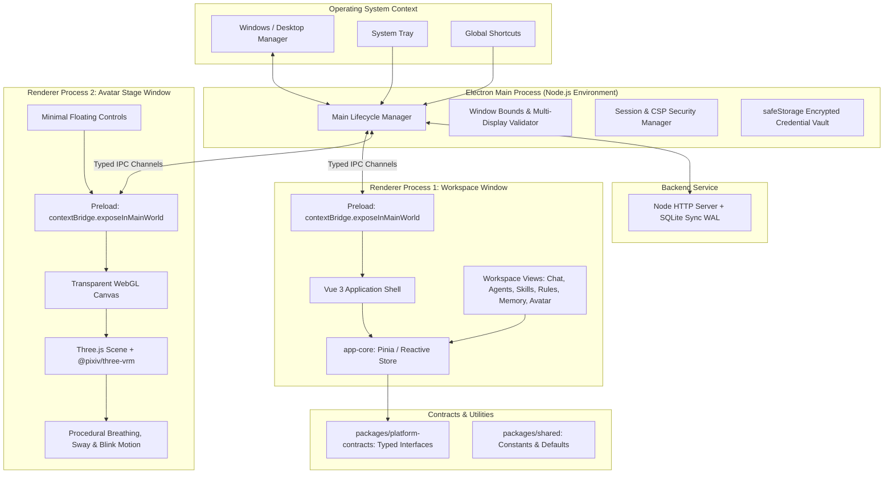

# YourCustomWaifu Desktop Architecture

## 1. System Philosophy
YourCustomWaifu is designed as a desktop-first personal AI companion. Unlike monolithic or browser-only interfaces, the application decouples into two native desktop surfaces:
- **Workspace Window**: Primary desktop workspace for conversational interaction, companion personalization (Agents, Skills, Rules, Tools, Memory, AI Connections), application settings, and account management.
- **Avatar Stage Window**: Frameless, transparent desktop window rendering a 3D VRM avatar with subtle idle motion, capable of floating persistently above everyday applications (such as VS Code, browsers, or games) even when the Workspace is closed.

## 2. Process Boundaries & Monorepo Topology

## 3. Window Decoupling Principles
1. **Independent Lifecycles**:
   - Closing Workspace (`mainWindow.close()`) does not close Avatar Stage or stop the companion runtime.
   - Hiding Avatar Stage (`stageWindow.hide()`) does not log out the user, destroy companion memory, or reset settings.
   - Only explicit **Quit Application** from the System Tray or App Menu terminates both processes.
2. **Single Stage Guarantee**:
   - `createStageWindow()` ensures exactly one `BrowserWindow` instance exists for the Stage. If already created, it restores/unhides the existing window without creating duplicate instances.
3. **No Direct Renderer-to-Renderer Access**:
   - Renderer windows do not communicate directly. All cross-window synchronization occurs via typed Electron Main IPC events (`stage:status-changed`, `stage:config-changed`).

## 4. Security Invariants
- `contextIsolation = true`: Preload runs in an isolated context; prototype pollution cannot compromise native APIs.
- `nodeIntegration = false`: Node.js APIs (`fs`, `child_process`, `net`) are inaccessible from renderer code.
- `sandbox = true`: Renderers execute within an OS-level sandbox.
- `validateIpcSender`: Every IPC invocation verifies that `event.sender` belongs to a known, non-destroyed window in the application registry.
